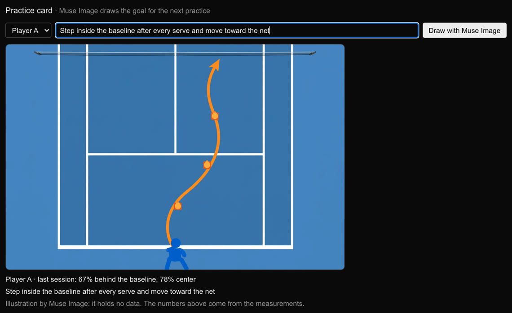

# CourtSense

[](https://github.com/EmirCobanOfficial/courtsense/actions/workflows/ci.yml)

Movement data from a tennis coach's training video, built on Meta **SAM 3.1** and **Muse Spark 1.3**.

> Built during the **Meta Global AI Developer Hackathon** (Oct 26 – Nov 4, 2026) for the problem statement **Build for Your World**. Nothing in this repository existed before the hackathon; the commit history shows the build. Pre-existing: our coach's training video, Meta's models and packages, and open-source libraries.

[](https://youtu.be/aLUSjad3vto)

Demo video (3 min): https://youtu.be/aLUSjad3vto

Website: https://emircobanofficial.github.io/courtsense-site/

## Meta AI in CourtSense

| Meta model or package | What it does here |
|---|---|
| **SAM 3.1** (Meta Model API) | finds both players and tracks them frame by frame through a session, in one streamed video request |
| **Muse Spark 1.3** (Meta Model API) | the coach assistant: picks its own tools, watches short clips of the session (video understanding), answers in English or Turkish; also writes the coach report |
| **Muse Voice Transcribe** (Meta Model API) | the coach can ask the assistant by voice, in English or Turkish; the words land in the question box to check before asking |
| **Muse Image** (Meta Model API) | draws the coach's goal for the next practice as a top-down drill card; the picture holds no numbers, the caption's come from the measurements |
| `@meta-sam/parser` | reads SAM 3.1's streamed output (boxes and masks per frame) |
| `@meta-sam/react`, `@meta-sam/graphics` | play the session in the browser with the SAM masks drawn on it |

## Why this is not a generic sports analyzer

The hackathon lists sports analyzers among the projects to avoid, because so many get built. We asked the organizers before building and again before submitting (Discord #questions, Oct 27 and Oct 28). Their ruling: a tennis performance tool is fair game here because using SAM 3.1 for it is a new take, as long as it's something we actually use. The difference:

- **Built for a real user.** Our coach films every practice with one camera behind the baseline. CourtSense is built around those sessions, and the coach's own voice note is in the demo.
- **SAM 3.1 is the core.** SAM 3.1 video segmentation tracks both players through a whole session from a text prompt. There is no pose model, no training data, and no extra cameras or sensors. Four clicks turn the video into court meters.
- **Answers a coach can check.** The Muse Spark assistant jumps the video to the moment it talks about. Every number in its answers and in the report is checked against the data, and rough values are marked as rough.

## What it does

A club coach films practice with one fixed camera behind the baseline. CourtSense turns that footage into numbers:

- **Upload** the session and pick the part to analyze (start / end time).
- **SAM 3.1** (Meta Model API, video segmentation) finds both players and tracks them frame by frame.
- **Four clicks** on court-line intersections calibrate the camera; every foot position becomes a point on the court, in meters.
- **Metrics** per player: distance, average and peak speed, time behind the baseline / at the baseline / mid-court / at the net, left / center / right split, side changes, and a measurement-confidence score.
- **Heatmap** (bird's-eye) and the **SAM masks drawn on the video**, rendered in the browser with Meta's `@meta-sam/react` and `@meta-sam/graphics`.
- **Coach assistant**: a Muse Spark agent answers questions such as "Where did Player A run fastest?". It chooses its own tools, jumps the masked video to the moment it talks about, can watch a short clip (Muse Spark video understanding), and every number in its answer is checked against the data before the coach sees it.
- **Ask by voice**: the coach can say the question instead of typing it. Muse Voice Transcribe turns it into text, with the language and tennis terms as hints, and the coach checks it before asking.
- **Coach report** written by Muse Spark from the measured numbers only. Its numbers go through the same check, and the report shows whether they passed ("✓ Verified" / "Not verified").
- **Practice card**: the coach writes a goal for the next practice, and Muse Image draws it as a drill on a top-down court, starting from where the player mostly stood. The prompt describes that in words, never in numbers, and asks for no text, so there is nothing in the picture to check; the numbers sit in the caption, straight from the metrics. $0.01 per card.

  
- English UI with a Turkish switch (the coach's language); the agent and the report answer in the selected language.

## How it works

```
video ──ffmpeg (1080p, 15 fps)──▶ SAM 3.1 "tennis player" ──▶ tracks.json (boxes per object id per frame)
                                                                   │
            4 calibration clicks ──▶ homography (image px → court m)
                                                                   ▼
             playerPositions(): foot points → court meters, bystanders and frame-edge boxes dropped,
             SAM id reuse and trades handled, far-side foot-row estimate, 1 s smoothing (2 s far-side depth)
                                                                   ▼
             metrics · heatmap · masks on video · coach assistant (typed or spoken) · report · practice card
```

Details that matter for accuracy:

- **Far-side feet.** SAM's box for the far player usually ends about 2 px above the feet, and there one pixel is about half a meter of depth. With a low camera the net sometimes cuts the box shorter, never lower.
  - The submitted version took the lowest box bottom within ±0.5 s. That cut the far player's depth noise from 2.4 m to about 0.4–0.55 m, but it also pulled a player moving in depth toward the camera.
  - The current version fits a line through the bottoms in that window (the player's motion) and adds their 90th percentile above it. See "Accuracy, measured" below.
- **Honest numbers.** A player's distance, speed and zone values are shown as rough (`~`) in two cases: their frame-to-frame depth jitter is above 0.3 m, or their expected depth error is above 0.6 m. The expected depth error comes from the hand-marked frames.
  - For a rough player, each zone share comes with a range: the time they were clearly in the zone, and the time they could have been.
  - The agent and the report say when a value is rough. Left / right stays reliable.
- **Tracking hygiene.** People outside the court (benches, the next court) are filtered by position; SAM sometimes hands a player's id to someone else later, so each id only counts inside the frame span where it belonged to that player. If SAM trades the two players' ids after they cross in the image, an id whose box leaves its player's reach for the other player's is matched again (no trade happened in our session; a test covers it). Boxes cut by a frame edge are dropped.
- **Cost.** SAM 3.1 video is $0.20 per 1,000 frames: a 12-minute session at 15 fps (10,688 frames) costs about $2.14. Only the chosen part of the video is sent, and results are cached on disk, so re-uploading the same file never pays twice. Economy mode (7.5 fps) costs half; see "Fewer frames" below.

## The coach assistant

The agent follows the loop from Meta's [legal-agent-workshop](https://github.com/meta-models/legal-agent-workshop): each turn Muse Spark 1.3 picks **one** tool (Responses API, `parallel_tool_calls: false`, `store: false` with encrypted reasoning replayed), our code runs it and sends the result back, up to 8 turns.

| Tool | What it does |
|---|---|
| `get_metrics` | session metrics per player, with reliability notes |
| `find_moments` | fastest 1 s moments, longest runs, visits to the net, in video time |
| `minute_breakdown` | meters per full minute |
| `show_moment` | jumps the coach's masked video to a time |
| `look_at_clip` | cuts 2–8 s of the video and asks Muse Spark what is visible |
| `answer` | the final answer; **verification runs here** |

Verification sits inside the `answer` tool, so the model cannot skip it (`lib/claims.ts`). The answer lists every number it writes as a claim: player, metric, value, unit, and the moment for timed values.

- **The claims** are checked against the session's facts: the values the tools return, rounded the same way. A wrong value, player, unit or moment is refused, and so is more precision than the data has.
- **The text** is checked against the claims. Every number in it (decimals with a comma or dot, percentages, m:ss times) must match a claim:
  - in the claim's unit;
  - after the claim's player;
  - not next to another metric's words;
  - with "about" / "yaklaşık" when the player is rough.

A refused answer goes back to the model with the reasons. After three refusals the answer is shown as "Not verified". The report goes through the same check, with one rewrite. The route streams each step to the UI as NDJSON.

## Agent evaluation

| Test | What it checks | Result |
|---|---|---|
| Offline test set (`validate/coach-eval.ts`, scripted fake model, $0) | 23 answers sent through the app's real answer loop and tools on the coach's session: 8 correct answers that must be accepted, 8 wrong ones that must be refused, and 7 that try to game the check (a true claim under a false text, no claims, a time hidden in `at`, extra decimals, a rough Turkish value without "yaklaşık", a pronoun pointing at the wrong player) | 23/23 |
| Live run (`validate/coach-live.ts`, Muse Spark 1.3, Oct 31, $0.198) | 8 real questions, including a false premise ("Player A ran 900 meters, right?") and one the data cannot answer ("How many forehands did Player A hit?"). Every answer is also audited offline | 8/8 verified, no audit flags |
| Unit tests (`lib/claims.test.ts`, in CI) | claim matching, units, decimals, rough-value hedges, English and Turkish | pass |

What the live runs show:
- The false premise was corrected ("No. Player A ran 567 m in this session."), and the forehand question was declined, because there is no ball tracking.
- The check catches the agent's own slips, and the agent fixes them. In the live run's pace question one draft was refused. In the demo video's voice question (2:13) two drafts were refused before the verified answer, and the step list shows both refusals.

## Accuracy, measured

After submission we measured positions against feet marked by hand on our coach's session (`validate/annotate`), and against simulated sessions with a known truth (`validate/step2.ts`). That led to the far-side change above. The submitted method is kept as `V1` in `lib/metrics.ts` to measure against.

| | Player A (near) | Player B (far): submitted → now |
|---|---|---|
| Position error, hand-marked frames not used to build the change¹ | 0.46 m, unchanged | 1.35 → 1.08 m |
| Depth bias, same frames | −0.36 m, unchanged | −0.76 → −0.14 m |
| Distance error, simulated sessions | −1%, unchanged | +16% → +6.5% |
| Behind-the-baseline share error, simulated | −0.6 pp, unchanged | −18.6 → −4.1 pp |

¹ 30 frames. For Player B only 15 count: in the rest the feet were not visible. The 95% interval of B's improvement is −0.01 to 0.54 m.

Notes:
- Player A's error is mostly a difference in definition: the app's foot point is the bottom of the box (the front foot), the hand mark is between the feet.
- The demo video was last updated on Nov 2 with the current version. The video submitted on Oct 28 is at https://youtu.be/C0gcC3CdusI; there Player B's distance reads 752 m, now about 650 m. Player A's numbers did not change.
- Details and limits are in [validate/README.md](validate/README.md).

### Fewer frames: a real 7.5 fps run

SAM bills per frame, so we sent the same session to SAM 3.1 again at 7.5 fps: every second frame of the 15 fps clip (`validate/fps-test.ts`). Frame k of that run is frame 2k of the baseline, so both compare at the same instants.

| | 15 fps (default) | 7.5 fps |
|---|---|---|
| Frames sent to SAM, cost | 10,688, $2.14 | 5,344, $1.07 |
| Identity swaps (an id crossing the net or moving to the other player) | 0 | 0 |
| SAM ids per player, A / B (SAM lost the player and gave a new id) | 3 / 4 | 5 / 2 |
| Frames with the player tracked, A / B | 92.1% / 99.0% | 92.0% / 99.2% |
| Position error on hand-marked frames, A / B (the even ones: 35 / 26) | 0.40 m / 1.05 m | 0.40 m / 1.05 m |
| Player A: distance, peak speed | 567 m, 2.01 m/s | 561 m (−1.1%), 2.00 m/s |
| Player B (rough): distance, peak speed | ~650 m, ~3.07 m/s | ~624 m (−4.0%), ~2.93 m/s (−4.6%) |
| Time behind the baseline, A / B | 67% / ~72% | 67% / ~73% |

At the same instants Player A's positions agree to 0.03 m and Player B's to 0.8 m (far-side depth). With half the samples, the measured path cuts a few more corners, so distance and peak speed read a little lower, most for the far player. The upload screen offers this as **Economy (7.5 fps)**, with **Standard (15 fps)** as the default, and shows the estimated SAM 3.1 cost before anything is sent (`lib/cost.ts`). Each mode keeps its own cached results, so a video analyzed in one mode never pays again in that mode.

## Code map

| Path | |
|---|---|
| `lib/court.ts` | court geometry, homography (DLT) |
| `lib/metrics.ts` | tracks → court positions → metrics and heatmap |
| `lib/jobs.ts` | job storage and processing (ffmpeg, SAM 3.1 request, caching) |
| `lib/coach.ts` | the agent: tools, loop, session facts |
| `lib/claims.ts` | the claim check for every number in answers and reports |
| `lib/transcribe.ts` | Muse Voice Transcribe for spoken questions (the route converts the recording to WAV with ffmpeg) |
| `lib/card.ts` | the practice card: the prompt from the player's measured pattern in words, and the Muse Image call |
| `lib/cost.ts` | SAM 3.1 pricing and the two modes, Standard (15 fps) and Economy (7.5 fps): the upload screen's estimate and the frame rate a job runs at |
| `lib/model.ts`, `lib/fake-model.ts` | the Meta Model API client; a scripted local model for trying the UI without API calls |
| `lib/report.ts` | Muse Spark coach report |
| `lib/i18n.ts` | English / Turkish UI strings |
| `app/page.tsx` | the UI (upload, calibration, metrics, report) |
| `app/components/` | `MaskVideo` (SAM masks on video), `Heatmap`, `CoachChat` |
| `app/api/jobs/…` | upload, video (HTTP Range), SAM output, calibration, report, ask (agent stream) |
| `scripts/demo/render-hero.ts` | renders the demo video's mask + bird's-eye clips from the same data |
| `lib/*.test.ts` | unit tests (`node:test`) |
| `validate/` | measurement tools: hand-marking page, simulated sessions, offline and budget-capped live checks of the assistant |

## Run it

Requirements: Node 22.18+ (the tests run TypeScript directly), `ffmpeg` and `ffprobe` on the PATH, and a Meta Model API key.

```bash
npm install
echo "MODEL_API_KEY=your-key" > .env.local
npm run dev            # http://localhost:3000
node --test lib/*.test.ts validate/*.test.ts
```

The same checks (types, lint, tests, production build) run on GitHub for every push.

Upload a video, set the analysis start and end, wait for SAM 3.1, click the four court points, and save.

To try the assistant, the report and the practice card without any API call, start the app with scripted local models:

```bash
COURTSENSE_FAKE_MODEL=good MODEL_API_KEY= npm run dev
```

With `=bad` instead, every answer has a wrong number, so it shows as not verified.

## Limitations

- No ball tracking: SAM 3.1 mistook ceiling lights and signs for the ball in our footage, so there are no shot or score statistics.
- With a low camera the far player's depth is rough: about 1 m of error on the hand-marked frames. The app marks it and gives ranges rather than guessing.
- The error figures come from one session and one camera position. A different setup needs its own hand-marked frames.
- Slow camera drift (gimbal pan) is not compensated yet.
- One SAM request covers up to 15,000 frames (about 16 minutes at 15 fps).

## Privacy

Training videos and SAM outputs stay in `data/`, which is git-ignored. The players consented to the recording being used for this project.

## License

MIT, see [LICENSE](LICENSE). The `@meta-sam/*` packages it depends on are under Meta's SAM License.
